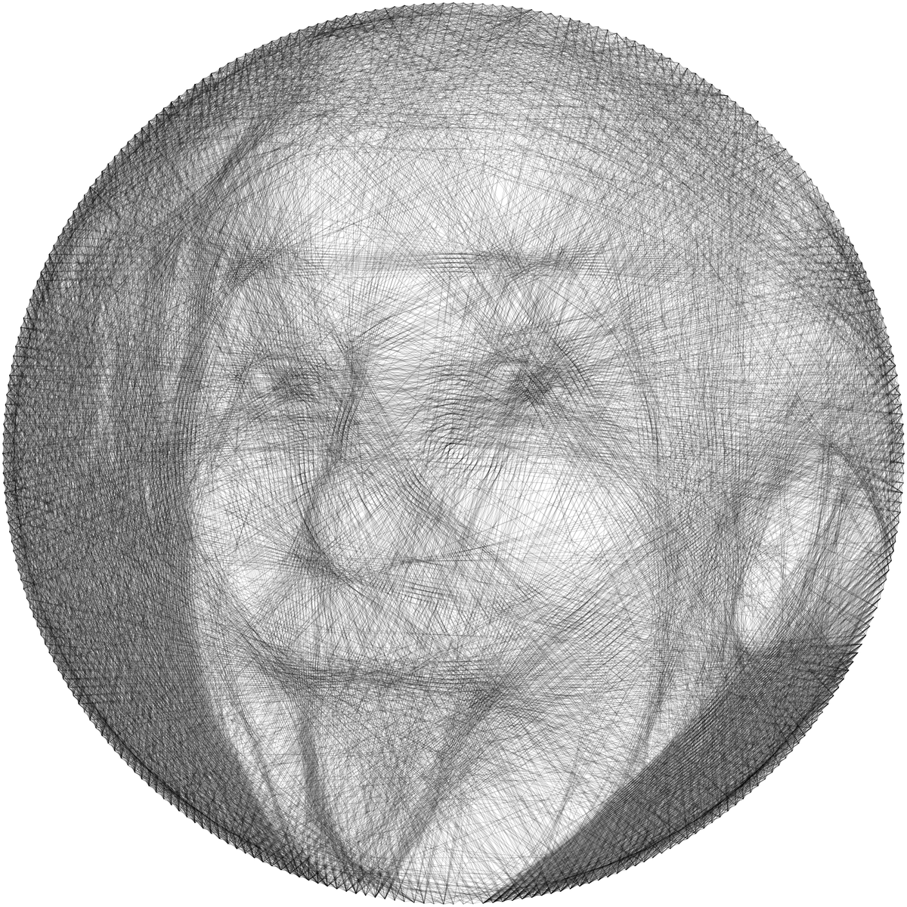
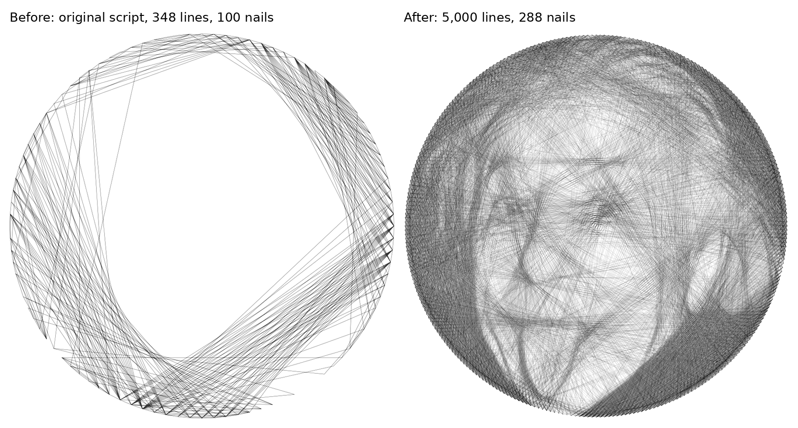

# string_art

Generate images using lines: nails are placed around a circle over a photo, and a single thread is run greedily from nail to nail, always picking the line that covers the darkest remaining part of the image.



## Scripts

- `string_art.py`: the original version (100 nails, up to 350 lines; saves the nail order to `nail_order.npy`).
- `string_art_hq.py`: a higher-quality version with the same greedy idea, plus these changes:
  - **Lighten instead of erase.** A chosen line lightens the pixels it covers by `--strength` instead of setting them to white, so dark areas can take many threads and build up tone. This is the biggest improvement.
  - **More nails and lines.** You set a fixed line budget (`--lines`) instead of the 350-line cap and moving-average stop.
  - **`--skip`.** Lines to nearby nails are blocked so thread doesn't pile up along the rim.
  - **Precomputed lines.** The pixels for every nail pair are computed once, so 5,000 lines take a few seconds.
  - **Preprocessing.** Autocontrast, gamma, an optional crop, and a circular mask.



## Run it

```bash
pip install numpy pillow matplotlib
python string_art_hq.py --input einstein_tongue.jpg --out einstein_tongue \
  --nails 288 --lines 5000 --strength 0.08 --skip 20 --gamma 1.8
```

Outputs are a rendered PNG, the nail order (`.npy` and `.txt`), and a JSON file of the parameters used. `einstein_tongue_nail_order.txt` lists the nail sequence for stringing it physically. Nails are numbered 0 to 287, counter-clockwise from 3 o'clock.

## Photo credit

Albert Einstein, 14 March 1951, by Arthur Sasse (International News Service), public domain via [Wikimedia Commons](https://commons.wikimedia.org/wiki/File:Albert_Einstein_sticks_his_tongue_1951.jpg).
